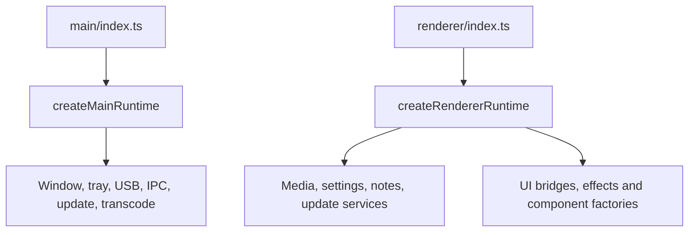
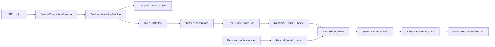
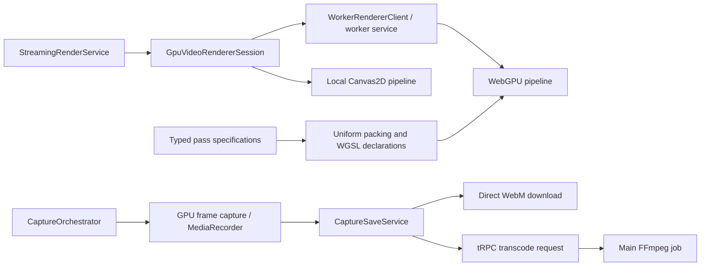
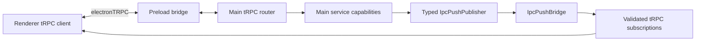

# Architecture and Ownership

PrismGB separates the Electron main process, preload bridge, browser renderer, and GPU worker. Public platform entrypoints are declared in `scripts/lib/workspace-aliases.mjs`; dependency-cruiser enforces process and module boundaries.

## Process Composition and Lifecycle

Each `application/container.ts` is an explicit construction function: `createMainRuntime` or `createRendererRuntime`. Dependencies are typed objects passed directly to constructors. The runtime owns initialization and disposal; services own their individual listeners, timers, and resources.

`createApplicationLifecycle` shares concurrent initialization and disposal promises. A failed initialization rolls back the constructed runtime once. `disposeInOrder` attempts each registered disposer even if another fails. A new startup constructs a fresh runtime and ownership graph.

Renderer UI factories preserve deferred construction in `UiComponentHost`. The renderer runtime establishes UI bridges before application initialization, then starts deferred components and input listeners. It disposes components before the notes service so pending edits can flush. Main composition passes Electron capabilities directly to platform services, including the typed push publisher, update-install callback, and transcode directories.

The renderer subscribes to shutdown requests before reporting readiness. During shutdown, main keeps IPC and the window alive, sends a request with a correlation ID, and waits for the renderer's typed acknowledgement. Renderer cleanup flushes pending notes and finishes recording/rendering cleanup before acknowledging. Main then waits for accepted conversions and registered downloads to finish before tearing down services, IPC, and the window. A missing or failed acknowledgement still attempts the output drains and tears down remaining owners; packaged smoke reports failure.

## Device and Streaming Flow

The device catalog defines USB matching, media constraints, native dimensions, and fixtures. Main owns USB status; renderer owns browser media selection. `DeviceIntegrationService` publishes device changes directly and performs tray/window side effects. Window ownership does not act as a general IPC transport.

Renderer event names and payload types are declared together in `event.manifest.ts`. `EventChannels`, event payload maps, and subscription types derive from that declaration. The event bus and `@OnEvent` subscriptions remain explicit renderer coordination tools; they do not require constructor metadata.

## Rendering and Capture

`StreamingRenderService` serializes session transitions, aborts superseded starts, and owns canvas replacement after transfer to a worker. It selects WebGPU when available, falls back to Canvas2D after GPU initialization failure, and uses Canvas2D for performance mode. Preset, brightness, viewport sizing, visibility, and recording state remain coordinated around the active session.

Pass specifications define uniform layouts and derive shader declarations; shader bodies retain the actual rendering algorithms. The worker protocol carries render commands, frame completion, errors, and correlated capture responses. Frame ownership and request correlation must be preserved when extending it.

Main transcoding owns active FFmpeg jobs and their temporary input/output artifacts. Successful output is moved to the downloads directory. Normal shutdown waits for accepted jobs; failure cleanup cancels remaining jobs. Completion, failure, cancellation, and application disposal all release temporary artifacts through the same job owner.

Before clicking a download anchor, renderer capture code registers its blob URL through the typed `expectDownload` request. Main tracks that registration through Electron's download completion, including downloads that start after renderer cleanup acknowledges. This registration lets shutdown wait for pending file writes without guessing when a browser download will begin.

## Cross-Process Contracts

The router is the source of request names and inputs/outputs. Zod validates process-boundary payloads, and shared DTOs infer types from their schemas. `IPC_CHANNELS` contains only main-to-renderer push events, with `IpcPushPayloadMap` defining their payloads. Subscriptions validate emitted values and drop malformed pushes without ending the subscription.

The renderer imports the router only as a type through its infrastructure layer. Preload exposes the small `electronTRPC` transport contract; renderer code does not receive general Node or Electron APIs. The package import patch and inlined preload adapter remain required by the currently pinned transport/build combination.

## Settings, Presentation, and Notes

Typed definitions in `settings.definitions.ts` supply keys, defaults, validation, event relationships, and control metadata. `SettingsService` exposes setting-specific values. Existing stored keys and representations remain compatible; login-item state comes from its operating-system service.

`PresentationModeStore` owns derived viewing state. `BodyClassManager` binds that state and performance state to DOM classes. UI bridges route notifications to components; reusable controllers own widget interactions and accessibility behavior.

`NotesService.updateNote` owns note mutations and persistence. The notes panel owns its child components and flushes pending edits during disposal. Search returns matching notes, while the list view owns their grouped rendering.

## Verification and Build Ownership

- The platform alias registry drives resolver configuration and generated TypeScript paths; `check:generated` rejects stale output.
- Knip checks files, exports, types, and dependencies twice: across the complete graph, then production alone. Only declared testkit surfaces are excluded from production, so test imports cannot hide unused runtime APIs.
- Dependency-boundary tests invoke dependency-cruiser's API against intentional invalid fixtures.
- CI runs the full Vitest suite once per selected platform and reuses its Linux Vite build for Playwright.
- Packaged smoke starts the normal main/preload/renderer path with a temporary profile. It requires renderer readiness, the shutdown request/acknowledgement, conversion/download drains, and completed main cleanup before emitting its success marker and exiting zero. Missing readiness or acknowledgement, timeout, signal termination, or cleanup failure fails the check.
- Vite's `assets` public directory owns renderer static assets; file URLs use a relative base. Packaging-only icons and entitlements live in `build-resources`, so the renderer does not ship unused ICO, ICNS or signing metadata. Packaging hooks retain native-library, signing, and AppImage compatibility responsibilities.
